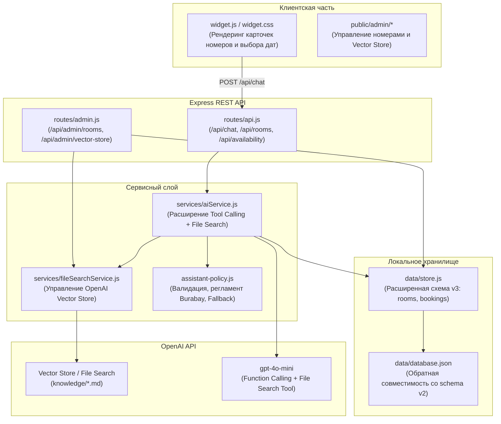

# План реализации базы знаний и модуля бронирования (Hotel v.2 — BURABAY ECO HOTEL)

**Документ:** Архитектурный план внедрения  
**Проект:** Hotel v.2 (BURABAY ECO HOTEL / WGB)  
**Статус:** План подготовлен к согласованию (реализация не начата)  
**Принцип модернизации:** Минимальные изменения существующей архитектуры без усложнения стека, без создания параллельных ботов, без поломки существующих 28 тестов.

---

## 1. Архитектурная концепция и цели модернизации

### Ключевые задачи
1. **Подключение OpenAI File Search (Assistants API / Vector Store):**
   - Перевод поиска по базе знаний с простого поиска по ключевым словам на семантический поиск по документам отеля с цитированием источников (OpenAI File Search).
   - Создание и выгрузка структурированных справочных файлов (эко-концепция, правила национального парка Бурабай, сезонные активности, спа и рестораны).
   - Сохранение полной работоспособности локального fallback-режима при отсутствии ключа или сбоях сети.
2. **Структурированные гостиничные данные:**
   - Переход от текстовой статьи о номерах к структурированному каталогу категорий номеров (Эко-коттеджи, Стандарты, Полулюксы, Семейные шале).
   - Учет вместимости (взрослые, дети), удобств, вида (озеро / сосновый бор) и сезонных тарифов.
3. **Функции бронирования:**
   - Инструменты для ИИ-ассистента: проверка доступности номеров на даты (`check_room_availability`), детальный расчет (`calculate_room_reservation`), формирование подтвержденной брони или лида.
   - Сохранение требования явного согласия на обработку персональных данных.

---

## 2. Стратегия минимальных изменений существующей архитектуры

### Архитектурные принципы:
- **Сохранение единой БД:** Не подключать вторую СУБД (PostgreSQL/MongoDB). Расширить схему существующего `database.json` новыми полями `rooms` и `bookings` с плавной авто-миграцией `schemaVersion: 3` в `data/store.js`.
- **Синхронный гибридный поиск:** 
  - При наличии рабочего OpenAI API используется семантический File Search через векторное хранилище (Vector Store).
  - При отсутствии API-ключа локальный движок `store.js` и `assistant-policy.js` обращается к структурированному каталогу номеров и локальным текстовым выдержкам.
- **Сохранение безопасности:** Все существующие барьеры (`isInternalDataOrSecurityAttempt`, `containsLeakedInternalData`, `requireAdminAuth`, маскирование ключей) остаются в силе.

---

## 3. Список файлов для изменения и создания

### 3.1. Файлы, которые необходимо СОЗДАТЬ

| № | Путь к файлу | Назначение |
|---|---|---|
| 1 | `knowledge/burabay_eco_hotel_guide.md` | Полная база знаний об отеле: философия эко-отеля, территория национального парка Бурабай, правила поведения в заповедной зоне, трансфер из Астаны/Кокшетау, check-in/out, конференц-зал. |
| 2 | `knowledge/rooms_and_rates.md` | Каталог номерного фонда для векторизации: категории (Standard Pine, Eco Chalet, Lake View Suite), площади, оснащение, типы кроватей, сезонность цен. |
| 3 | `knowledge/services_and_spa.md` | Описание ресторанов, эко-питания, банного комплекса, спа-процедур, проката инвентаря (велосипеды, лыжи, сапы), экскурсий по озеру Боровое. |
| 4 | `services/fileSearchService.js` | Сервис для работы с OpenAI Vector Stores: загрузка файлов `knowledge/*.md`, привязка к ассистенту, проверка статуса векторизации, синк через админку. |
| 5 | `tests/rooms_and_booking.test.js` | Автоматические тесты для каталога номеров, проверки доступности дат, новых инструментов ИИ и бронирования. |

### 3.2. Файлы, которые необходимо ИЗМЕНИТЬ (минимальные правки)

| № | Путь к файлу | Необходимые изменения |
|---|---|---|
| 1 | `data/store.js` | 1. Добавить дефолтную коллекцию `rooms` (каталог номеров Burabay Eco Hotel) и `bookings` в `getDefaults()`. 2. Реализовать методы: `getRooms()`, `getRoomById(id)`, `checkAvailability(start, end, category)`, `createBooking(bookingData)`. 3. Обеспечить сохранение совместимости со старыми базами (автоматический апгрейд до `schemaVersion: 3`). |
| 2 | `services/aiService.js` | 1. Добавить новые инструменты в `getTools()`: `check_room_availability`, `get_room_catalog`, `calculate_room_reservation`. 2. Добавить интеграцию с `fileSearchService` для семантического поиска контекста перед отправкой в модель (или переключение на Assistant с `file_search`). 3. Обновить `executeTool()` для работы с каталогом номеров. |
| 3 | `assistant-policy.js` | 1. Добавить правила консультаций по эко-отелю Burabay (заповедная зона, правила парка, сезонные цены). 2. Добавить в локальный `fallback` поддержку вопросов о категориях номеров и наличию мест из каталога `store.getRooms()`. |
| 4 | `routes/api.js` | 1. Добавить публичный эндпоинт `GET /api/rooms` (список категорий для виджета и калькулятора). 2. Добавить эндпоинт `POST /api/bookings/check` (проверка доступности дат). 3. Интегрировать бронирование с привязкой выбранного номера в заявку `POST /api/lead`. |
| 5 | `routes/admin.js` | 1. Добавить CRUD-маршруты для каталога номеров (`GET/POST/PUT/DELETE /api/admin/rooms`). 2. Добавить роут `POST /api/admin/vector-store/sync` для запуска синхронизации документов с OpenAI. |
| 6 | `widget.js` | 1. Добавить рендеринг карточек категорий номеров в сообщениях чата при запросе подбора жилья. 2. Добавить быстрый выбор дат для проверки доступности номеров. |
| 7 | `public/admin/index.html` и `admin.js` | 1. Добавить вкладку «Номерной фонд» для управления номерами и ценами без правки кода. 2. Добавить кнопку и индикатор синхронизации Vector Store в разделе OpenAI. |
| 8 | `tests/assistant.test.js` | Убедиться, что все 21 исходный тест проходят без регрессий при добавлении новых инструментов и правил. |

---

## 4. Этапы реализации

### Этап 1: Структурирование данных отеля (Data Layer)
- Создание файлов знаний в каталоге `knowledge/*.md` (Burabay Eco Hotel).
- Добавление каталога номеров в `data/store.js`:
  - `standard_twin` — Уютный номер с видом на сосновый лес.
  - `eco_chalet` — Отдельно стоящее шале из натурального сруба.
  - `lake_suite` — Панорамный полулюкс с видом на озеро Боровое.
  - `family_cottage` — Семейный коттедж с кухней и зоной барбекю.
- Добавление календаря броней и проверок пересечения интервалов дат.

### Этап 2: Интеграция OpenAI File Search (AI Services)
- Разработка `services/fileSearchService.js` через официальный OpenAI SDK (`openai.beta.vectorStores`).
- Создание механизма загрузки markdown-документов базы знаний в Vector Store отеля.
- Интеграция семантического поиска в `aiService.js`: получение точных выдержек со ссылками на первоисточники (без риска галлюцинаций цен).

### Этап 3: Расширение инструментов бронирования (Function Calling)
- Реализация новых инструментов в `services/aiService.js`:
  - `get_room_catalog(filter)`: получение списка номеров по параметрам (число гостей, бюджет, вид).
  - `check_room_availability(category, startDate, endDate)`: проверка свободных мест в локальном хранилище.
  - `calculate_room_reservation(roomId, startDate, endDate, guests, mealPlan)`: детерминированный расчет проживания с учетом сезона и выбранной категории.
- Сохранение принципа безопасности: финальная фиксация контактов и подтверждение брони оформляется через проверенную форму с согласия гостя.

### Этап 4: Пользовательский интерфейс и администрирование
- Отображение мини-карточек номеров в виджете чата при консультации.
- Панель управления номерным фондом и кнопка ручной переиндексации файлов в админке.

### Этап 5: Автоматизированное тестирование и регрессионный контроль
- Разработка нового набора тестов в `tests/rooms_and_booking.test.js`.
- Прогон полного пакета тестов (`npm test`) для подтверждения сохранения 100% работоспособности базовых 28 тестов.

---

## 5. Оценка рисков и способы их снижения

| Риск | Уровень | Меры снижения |
|---|---|---|
| **Галлюцинации модели относительно цен и наличия** | Высокий | Жесткий системный регламент (`assistant-policy.js`): цены берутся только из функции калькулятора, статус наличия верифицируется через `check_room_availability`. |
| **Исчерпание лимитов / недоступность OpenAI API** | Средний | Автоматический переход на локальный fallback, который опрашивает локальный каталог `store.getRooms()` без падения сервиса. |
| **Утечка персональных данных гостей** | Высокий | Сохранение входных и выходных фильтров безопасности, маскирование API-ключей, изоляция файлов базы от веб-раздачи. |
| **Поломка существующих интеграций и тестов** | Низкий | Обратная совместимость структуры `database.json`, запуск `npm test` на каждом этапе. |

